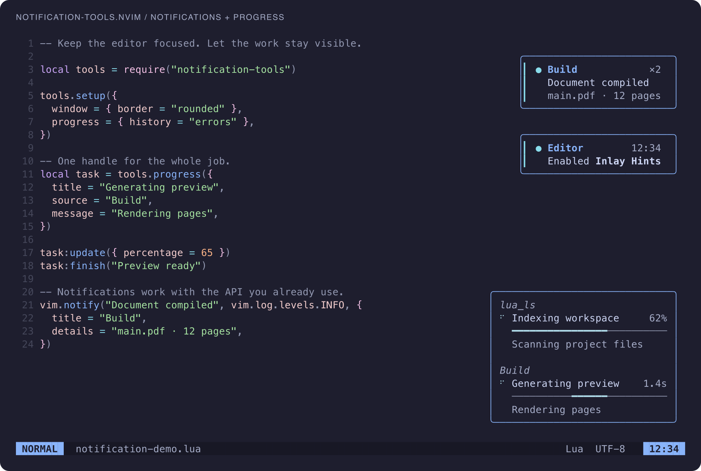
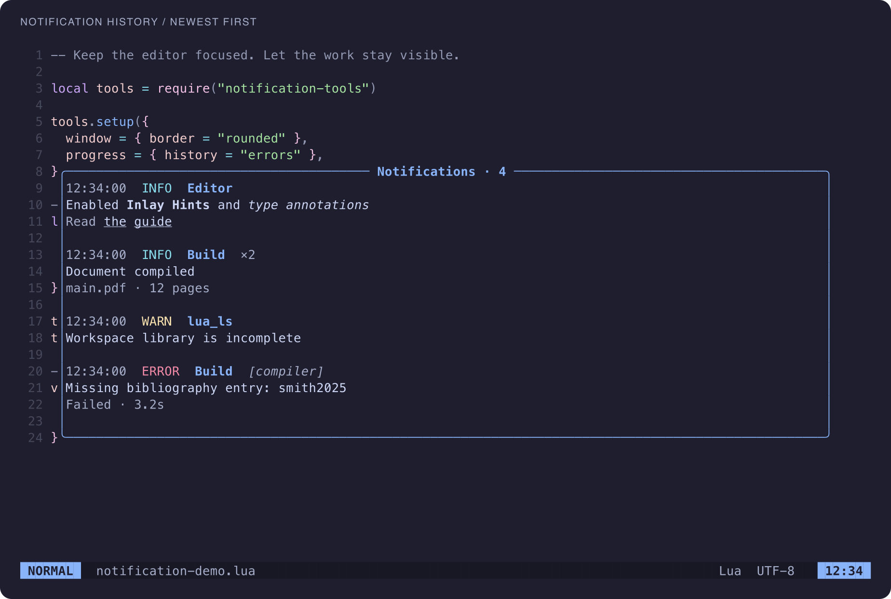
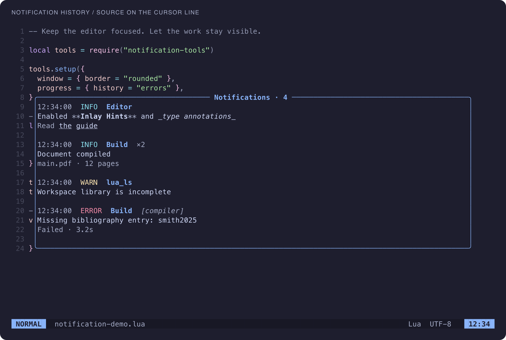

<div align="center">

# notification-tools.nvim

**Clear notifications. Quiet progress.**

Markdown-aware notifications, grouped task progress, and a history worth opening.

[Install](#installation) · [Task API](#give-your-plugin-a-progress-handle) · [History](#a-history-you-can-read) · [Configuration](#configuration) · [Help](doc/notification-tools.txt)

</div>



<sub>Actual Neovim UI, captured with Catppuccin Mocha and the highlight palette in [the screenshot scene](scripts/screenshot-scene.lua).</sub>

## Keep the work visible

- **Readable notifications.** Rounded cards, severity accents, inline Markdown, repeat counts, and secondary details.
- **Progress that stays out of your way.** Source groups, progress bars, animated waiting indicators, percentages or elapsed time, and optional LSP progress.
- **A useful history.** Newest messages first, severity/source/title filters, native search and yanks, and cursor-line Markdown source reveal.
- **Time to read.** Open a full notification and pause its remaining timeout until you close the reader.
- **Control the noise.** Do not disturb, history-only routes, and a small synchronous filter API.
- **A small integration surface.** No runtime dependencies. Producers own their events, jobs, and cancellation; the plugin provides the UI and handles.

Requires **Neovim 0.10+**. Supports Unicode, multiline messages, small screens, theme changes, and repeated setup/teardown.

## Installation

With [lazy.nvim](https://github.com/folke/lazy.nvim):

```lua
{
  "Jacky-Lzx/notification-tools.nvim",
  main = "notification-tools",
  lazy = false,
  priority = 1100, -- Load before plugins that send notifications.
  opts = {},
  keys = {
    { "<leader>n", "<Cmd>Notifications<CR>", desc = "Notification history" },
    { "<leader>un", "<Cmd>NotificationsDismiss<CR>", desc = "Dismiss notifications" },
  },
}
```

Without a plugin manager, add this repository to `runtimepath` and call:

```lua
require("notification-tools").setup()
```

Try `:NotificationToolsDemo` to preview both corners, or run `:checkhealth notification-tools` to check the setup. `require()` alone has no setup side effects; the first API call initializes defaults if needed.

## Send a notification

`setup()` owns `vim.notify` by default, so existing producers can keep using it.

```lua
vim.notify("Enabled **Inlay Hints**", vim.log.levels.INFO, { title = "Editor" })

local tools = require("notification-tools")
local id = tools.notify("Connecting…", "info", {
  title = "Connection",
  source = "my-plugin",
  details = "api.example.com",
  timeout = 0, -- Pin until replaced or dismissed.
})

tools.notify("Connected", "info", { id = id, timeout = 1500 })
tools.dismiss(id)
```

`notify(message, level?, opts?)` returns a string/number ID, or `nil` when discarded. Levels accept `vim.log.levels` values or case-insensitive names: `trace`, `debug`, `info`, `warn`, `error`, `off`. Table messages use `vim.inspect`.

| Option | Behavior |
| --- | --- |
| `id` / `replace` | Update an existing record. `replace` accepts an ID or `{ id = ... }`. |
| `title` / `source` | Display title and filterable origin; source defaults to title. |
| `details` / `icon` | Optional secondary text and severity icon override. |
| `timeout` | Lifetime in milliseconds; `0` pins the notification. |
| `markdown` | Override inline Markdown for one notification. |

Without an explicit ID, identical active notifications merge into one card, show `×N`, and restart their timeout. Matching includes source, title, body, details, severity, icon, timeout, and Markdown mode. Explicit updates preserve the count until content changes. Set `notification.merge_duplicates = false` to disable merging.

### Inline Markdown, original text preserved

Bodies and details support **bold**, _italic_, `code`, ~~strikethrough~~, and `[label](url)` links, including nested styles and escaped punctuation. Popups measure and wrap the rendered text. History and API snapshots retain the original Markdown and complete URLs.

Set `notification.markdown = false` globally, or pass `{ markdown = false }` for literal logs/code. Titles and tasks remain plain text. Formatting is inline and limited to one logical line; block layouts, tables, HTML, and fenced-code highlighting are outside the renderer's scope.

## Give your plugin a progress handle

```lua
local task = require("notification-tools").progress({
  id = "my-plugin:build:1", -- Optional; namespace custom IDs.
  title = "Building document",
  source = "my-plugin",
  message = "Starting…",
  percentage = 0,
})

task:update({ percentage = 65, message = "Compiling references" })
task:finish("PDF ready")
-- Or: task:finish("Compiler failed", "error")
-- Or: task:cancel("Stopped by user")
```

`update()` accepts `title`, `source`, `message`, `percentage`, and `history`; omitted fields keep their values. Percentages are clamped to integer `0..100`. `finish(message?, status?)` accepts `success` (default), `error`, or `cancelled`. `cancel()` marks the display as cancelled; the caller cancels the actual job.

The same active ID returns the same handle. Completed IDs can be reused; old handles become inert after completion, eviction, `clear_tasks()`, `setup()`, or `teardown()`. Mutation methods return the handle, and `is_active()` reports whether it still accepts updates. See [examples/task.lua](examples/task.lua).

### Progress bars by default

Each task displays a bar below its title. Known percentages fill the track from 0 to 100; tasks without a percentage show a bouncing segment and elapsed time. Successful completion fills the bar; failures and cancellations retain the known progress with their status color.

Bars use the available window width. On short or narrow screens they fall back to the compact task row, keeping titles and percentages visible. To use the original spinner-and-text layout everywhere:

```lua
require("notification-tools").setup({ progress = { style = "compact" } })
```

`progress.style = "bar"` is the default. Fill colors follow `NotificationToolsProgress`, `Done`, `ERROR`, and `Cancelled`; the unfilled track uses `NotificationToolsProgressTrack`.

### Keep failures after the task disappears

By default, `progress.history = "errors"` saves failed and timed-out tasks to notification history. Set it to `"all"` to include successful/cancelled runs, or `false` to disable it. Override per task with `progress({ history = ... })` or `task:update({ history = ... })`.

Each run has an independent history ID, preserving its `task_id`, source, final message, `status`, and `duration` in milliseconds. Success maps to INFO, failure to ERROR, cancellation to WARN. Results share `history_size`, never create extra popups, and use the task policy rather than ordinary notification filters, minimum severity, or DND.

LSP work-done progress is enabled by default. Ignore specific clients with `lsp.ignore`, or disable the subscription with `lsp.enabled = false`. Silent tasks time out after 120 seconds; set `progress.stale_timeout = 0` for producers that manage their own lifetime.

## A history you can read



Open `:Notifications`, or start with filters:

```vim
:Notifications level=warn source=lua_ls
```

| Key | Action |
| --- | --- |
| `/`, `y` | Native search and copying. Yanks preserve original Markdown. |
| `]n` / `[n` | Next / previous notification in the displayed order. |
| `gl` | Choose a minimum severity. |
| `gs` | Choose an exact source. |
| `gt` | Filter by a case-insensitive title substring. |
| `r` | Refresh while keeping the window, buffer, and selected record position. |
| `R` | Reset filters and refresh. |
| `<CR>` | Read the selected notification or task result in full. |
| `q` / `<Esc>` | Close. |

Unchanged history entries reuse their formatted text and Markdown spans. Refreshing an unchanged snapshot preserves its existing text and highlight extmarks.

Filters intersect. Fresh history opens with the most recently created/updated record at the top. New messages do not interrupt reading; press `r` to fetch them. Filters and the visible record count appear in the window title.

**Move onto a line to see its Markdown source.** Other lines stay concealed; leaving the line hides the markers again. The buffer text never changes.

<details>
<summary>See cursor-line source reveal</summary>



</details>

`:NotificationsLatest` opens the latest created/updated ordinary notification. Reading an active notification pauses its remaining timeout; closing the reader resumes that remaining time. Replacements/merges reset the paused remainder to the new timeout. Expired or dismissed notifications can be read from history without resurrecting a popup.

```lua
local tools = require("notification-tools")
tools.show_notification()   -- Latest ordinary notification; returns its ID or nil.
tools.show_notification(id) -- A specific live notice or retained history record.
tools.show_history({ level = "warn", source = "compiler", title = "Build" })
```

Use the Lua API for filter values containing spaces. History is session-only. `history()` returns an independent **oldest-first** snapshot; the history window displays it newest-first. Reading a live notice also works with `history_size = 0`.

## Turn down the noise

`:NotificationsDnd` toggles do not disturb; explicit `on`, `off`, and `toggle` arguments are supported. By default, only ERROR notifications pop up during DND. Other notifications remain in history, existing lower-severity popups close, and disabling DND does not replay them. The task panel stays active.

```lua
require("notification-tools").setup({
  notification = {
    dnd_level = "error", -- "off" suppresses every ordinary popup during DND.
    filter = function(notice)
      if notice.source == "noisy-plugin" then return "drop" end
      if notice.source == "background-build" then return "history" end
      return "show" -- nil also means normal display, subject to DND.
    end,
  },
})
```

The synchronous filter receives independent normalized fields: message, level, title, source, details, icon, Markdown mode, timeout, and any explicit ID. The global minimum `level` runs first. Invalid results or callback errors report an error and fall back to `"show"`, without recursive `vim.notify` calls.

`set_dnd(boolean)`, `toggle_dnd()`, and `is_dnd()` return the resulting/current state.

## Configuration

Defaults work without configuration. Notifications and progress inherit the shared `window` settings and can override them independently.

<details>
<summary>Common options and their defaults</summary>

```lua
require("notification-tools").setup({
  notify = true, -- false keeps the explicit API without replacing vim.notify.
  level = vim.log.levels.INFO,
  timeout = 4000,
  history_size = 200, -- 0 disables all history, including task results.
  max_notifications = 5,
  max_pending = 100, -- Separate bounds for active notices and tasks.
  window = {
    border = "rounded", -- single, double, solid, none, or "" also supported.
    winblend = 0,
    min_width = 24,
    max_width = 60,
    max_height = 8,
    top = 1, right = 1, bottom = 1,
    zindex = 150,
    gap = 1,
    padding = { horizontal = 1, vertical = 0 },
  },
  notification = {
    dnd = false,
    dnd_level = "error",
    markdown = true,
    merge_duplicates = true,
    timestamp = true,
    fade_out = 180, -- Within the existing lifetime; 0 disables fading.
    window = { padding = { horizontal = 2, vertical = 0 } },
  },
  progress = {
    enabled = true, -- API remains available when the panel is disabled.
    style = "bar", -- "compact" restores spinner-and-text rows.
    max_items = 6,
    done_ttl = 1500,
    history = "errors", -- "all" or false also supported.
    stale_timeout = 120000,
    interval = 80,
    group_by_source = true,
    show_elapsed = true,
    fade_out = 240,
    window = { min_width = 24, max_width = 44, max_height = 12 },
    avoid = { "NvimTree", "TestExplorer" },
  },
  lsp = { enabled = true, ignore = {} },
})
```

Full defaults: [config.lua](lua/notification-tools/config.lua). Detailed reference: [`:help notification-tools`](doc/notification-tools.txt).

</details>

Notifications and the task panel follow the active tab. Switching tabs closes a reader and resumes its paused timeout.

Parsed notification content is reused across timeout, title, and repeat-count updates. Unchanged layouts are cached by display constraints. Preview wrapping stops at the visible line budget while retaining full source text in history.

Widths use display cells and only grow during a float's lifetime, except when the screen shrinks. Small screens drop optional task gaps, details, bar rows, and source labels before hiding tasks. Hidden notifications still expire. Fades stay inside the configured lifetime, and completed tasks fade independently of active siblings. True-color terminals give the best blending.

### Theme it with highlight groups

Colors follow `NormalFloat`, `FloatBorder`, `Diagnostic*`, and your theme. Override individual groups with `nvim_set_hl`, including from a `ColorScheme` autocmd:

```lua
vim.api.nvim_set_hl(0, "NotificationToolsNormal", { link = "Normal" }) -- Match the editor background.
vim.api.nvim_set_hl(0, "NotificationToolsBorder", { fg = "#89b4fa" })
vim.api.nvim_set_hl(0, "NotificationToolsBody", { fg = "#cdd6f4" })
vim.api.nvim_set_hl(0, "NotificationToolsSource", { link = "Comment" })
```

Use `NotificationToolsNotificationNormal` and `NotificationToolsProgressNormal` for separate surfaces. The empty bar track uses `NotificationToolsProgressTrack`. Other groups include `Title`, `Body`, `TaskTitle`, `Meta`, `Source`, `ERROR/WARN/INFO/DEBUG/TRACE`, `Progress`, `Done`, `Cancelled`, `MarkdownCode`, and `MarkdownLink`, each prefixed with `NotificationTools`.

## Integrate with your setup

Disable other notification/progress owners to avoid duplicate displays: Fidget progress, Snacks notifier, or Noice's `notify` and `lsp.progress` features, depending on your setup.

For Noice message routes, [examples/noice.lua](examples/noice.lua) provides an optional configuration-side adapter. Copy it into your config as `lua/integrations/notification_tools_noice.lua`, then set:

```lua
-- Noice options
{
  views = require("integrations.notification_tools_noice"),
  notify = { enabled = false },
  lsp = { progress = { enabled = false } },
}
```

The adapter is loaded by your configuration; the plugin itself has no Noice/NUI dependency. Other producers can use the same public notification/task API without adding producer-specific integrations to the plugin.

## Commands and lifecycle

| Command | Action |
| --- | --- |
| `:Notifications [level=…] [source=…] [title=…]` | Open filtered history. |
| `:NotificationsLatest` | Read the latest ordinary notification in full. |
| `:NotificationsDnd [on\|off\|toggle]` | Control do not disturb. |
| `:NotificationsDismiss` | Dismiss ordinary notifications, retaining history and tasks. |
| `:NotificationsClear` | Clear history. |
| `:NotificationToolsDemo` | Preview notifications and tasks. |
| `:checkhealth notification-tools` | Check requirements and competing owners. |

The API also provides `dismiss(id?)`, `history(opts?)`, `clear_history()`, `tasks()` (newest-first snapshots), `clear_tasks()`, and `teardown()`. After main-loop setup, notification/task methods can be called from libuv callbacks; window work is scheduled onto the main loop. Repeated `setup()` clears the previous instance. Teardown releases windows, timers, autocmds, and commands, restoring the prior `vim.notify` only if the plugin still owns it. A deadline-based scheduler sleeps between static notifications and schedules visible animation/fade frames only. Bursty producer updates are coalesced, and changed rows are updated without rebuilding unrelated highlights. No idle refresh timer is retained.

## Development

```sh
sh tests/run.sh
```

Requires Neovim and StyLua. The suite isolates state/cache/data and covers API ownership, fast events, routing/DND, source-aware merging, task lifetimes, Unicode layout, Markdown styles/conceal, history filters and anchored refresh, result retention, reader timeout handling, and cleanup.

Optional installed-plugin checks:

```sh
NOTIFICATION_TOOLS_LAZY_ROOT=/path/to/lazy.nvim \
NOTIFICATION_TOOLS_NOICE_ROOT=/path/to/noice.nvim \
NOTIFICATION_TOOLS_NUI_ROOT=/path/to/nui.nvim sh tests/run.sh
```

Real terminal checks: `nvim -n -u tests/tui.lua -i NONE`, `tests/history_tui.lua`, or `tests/reading_tui.lua`. Set `NOTIFICATION_TOOLS_THEME_ROOT=/path/to/catppuccin` for Catppuccin Mocha and `NOTIFICATION_TOOLS_TUI_EXIT=1` to exit after verification. Results are written to `NOTIFICATION_TOOLS_TUI_RESULT` or each script's default temporary path.

To regenerate the images, run `python3 scripts/screenshots.py` (Neovim, Python 3.9+, and `rsvg-convert` required). The script captures Neovim's real RGB UI redraw events, including plugin windows and conceal, then rasterizes that grid to PNG. Set `NOTIFICATION_TOOLS_THEME_ROOT` for Catppuccin and `--font` to select an installed monospace font. It adds no plugin runtime dependencies.

### Internal structure

- `init.lua` owns the public API, integration wiring, and instance lifetime.
- `state.lua` owns notification/task transitions, retention, snapshots, and deadlines.
- `scheduler.lua` coalesces updates and manages a cancellable one-shot timer.
- `text.lua`, `markdown.lua`, and `layout.lua` handle bounded text processing and cached layout plans.
- `view.lua` applies row-level floating-window changes; `history.lua` owns browsing and per-record formatting caches.
- `records.lua` filters records without importing UI code; `commands.lua` manages command registration and ownership.

Internal history browsing reads retained records without constructing public snapshots. Public `history()` results remain independent copies. Caches are bounded by retained records and released on teardown.

For a repeatable 105 KB message microbenchmark (warm layout, bounded wrapping, and metadata updates):

```sh
nvim --headless -n -u NONE -i NONE --noplugin -l scripts/benchmark.lua
```

Results are JSON in milliseconds and depend on the machine/Neovim build. They measure layout work, not complete interactive UI latency.

## License

[MIT](LICENSE)
