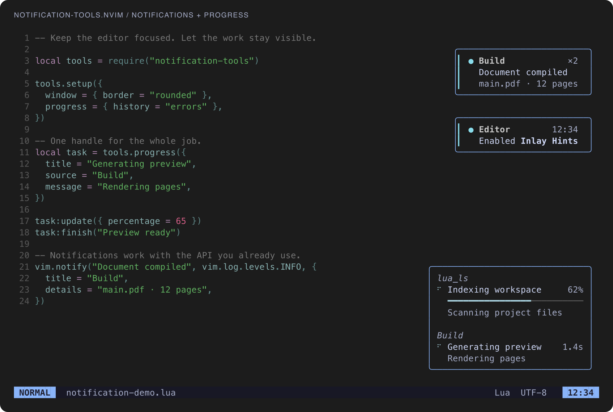
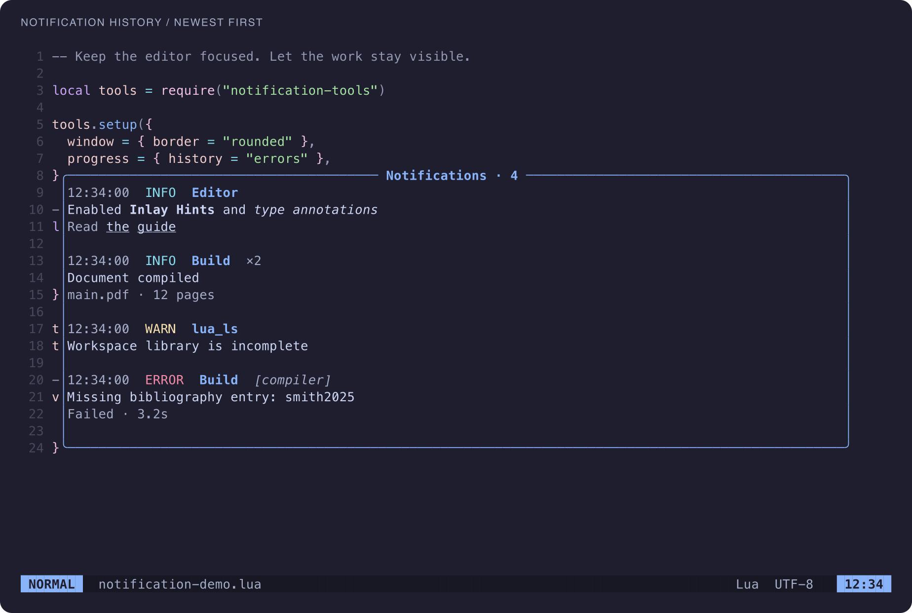
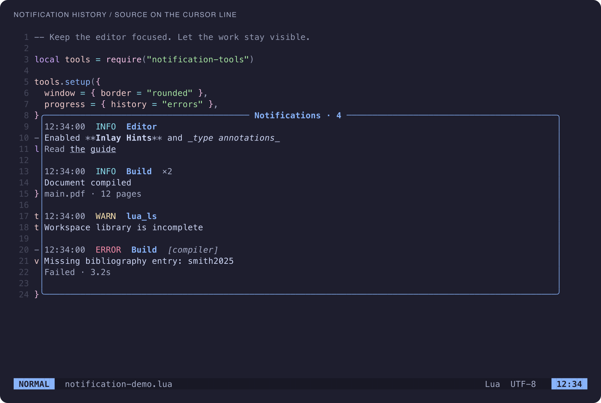

# Screenshots

[Quick start](../README.md)

Existing captures from real Neovim sessions. See the linked reproduction tools
where supplied by the original workflow documentation.

Neovim showing Markdown notifications at the top right and grouped LSP and build progress at the bottom right

Colored notification history with newest records first, concealed Markdown, repeat counts, warning levels, and a retained task failure

The same history window with Markdown delimiters visible only on the cursor line
